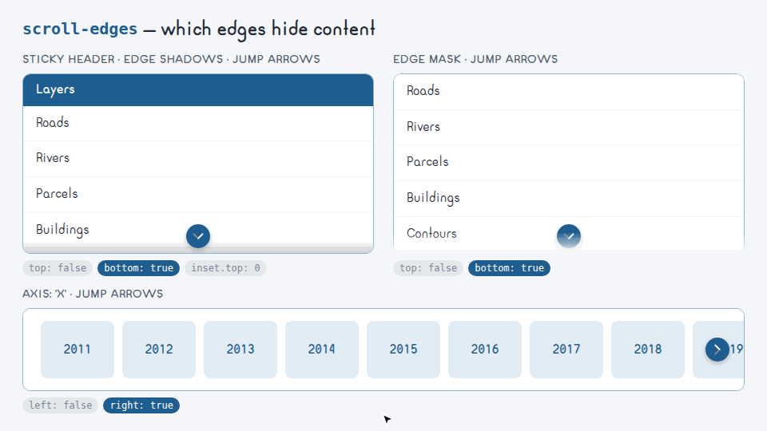

# <picture><source media="(prefers-color-scheme: dark)" srcset=".github/assets/icon-dark.svg"></picture> scroll-edges

[](https://www.npmjs.com/package/scroll-edges)
[](https://bundlejs.com/?q=scroll-edges)
[](LICENSE)

Headless scroll overflow for React: which edges hide content, sticky insets, jump-to-edge arrows and an edge mask.



scroll-edges owns the measuring — which edges of a scroll container hide content, how tall the stuck
sticky header is, when to measure again — and you own every pixel: it ships no styles, only state,
`data-*`/ARIA attributes and functional inline style (sticky anchors and an optional `mask-image`).
The arrows, the color fade and the hidden scrollbar are yours.

## Install

```bash
npm install scroll-edges
```

| Entry | What it is | Needs |
|---|---|---|
| `scroll-edges` | Framework-free core: `createScrollEdges` and `edgeMask` | nothing |
| `scroll-edges/react` | `useScrollEdges` with prop getters | `react >= 19` |

## Quick start

```tsx
import { useScrollEdges } from 'scroll-edges/react';

export function List({ items }: { items: string[] }) {
    const { state, getContainerProps, getAnchorProps, getArrowProps } = useScrollEdges({ jump: true, mask: true });
    return (
        <ul {...getContainerProps({ className: 'list' })}>
            <li {...getAnchorProps('top')}>{state.top && <button {...getArrowProps('top')}>↑</button>}</li>
            {items.map((item) => <li key={item}>{item}</li>)}
            <li {...getAnchorProps('bottom')}>{state.bottom && <button {...getArrowProps('bottom')}>↓</button>}</li>
        </ul>
    );
}
```

## Edges

The state is `{ top, right, bottom, left, inset }`: each edge is `true` while content hides past it.
Edges are physical, so `left` and `right` stay put in right-to-left containers.

| Option | Default | |
|---|---|---|
| `axis` | `'y'` | `'x'`, `'y'` or `'both'`; edges of the other axis stay `false` |
| `threshold` | `1` | Pixels of slack before an edge counts as overflowing |

## Sticky insets

Elements matching `sticky` (default `'[data-sticky]'`, `false` to skip) that are stuck to an
overflowing edge give their size to `state.inset` for that edge. A stuck header of 40 px gives
`inset.top === 40`, so the top anchor and its arrow sit below the header instead of under it. With
several sticky elements on one edge, the largest wins.

## Jump arrows

An arrow lives inside an anchor: a zero-size `position: sticky` element with `pointer-events: none`,
offset by the sticky inset. Place the `top`/`left` anchors before the content and the `bottom`/`right`
anchors after it. Render the arrow when its edge is `true`.

| `jump` | Arrows |
|---|---|
| `false` (default) | Decorative: `aria-hidden` |
| `true` | Buttons that scroll to their edge, with `aria-label` and `pointer-events: auto` |
| `{ items, min }` | Buttons only from `min` items on; below that, decorative |

`behavior` (default `'smooth'`) is the scroll behavior of the arrows, and `labels` replaces the
English `aria-label` per edge.

## Edge mask

`mask: true` (or `{ size }`, default `'10%'`) fades the overflowing edges with a `mask-image`
gradient on the container. With both axes overflowing it layers two gradients with
`mask-composite: intersect`. `edgeMask(state, { size })` returns the same style on its own.

## Measuring

The container is measured on scroll and when the container, its direct children or its sticky
elements change size, batched in one animation frame. Added and removed children are observed as
they come and go. The state keeps its reference while nothing changes, so it is safe for
`useSyncExternalStore`. `check()` measures right away.

## Core

```ts
import { createScrollEdges, edgeMask } from 'scroll-edges';

const list = document.querySelector<HTMLElement>('.list');
const edges = createScrollEdges({ axis: 'y' });

edges.subscribe(() => {
    const state = edges.getState();
    list?.toggleAttribute('data-overflow-bottom', state.bottom);
    list?.style.setProperty('mask-image', edgeMask(state, { size: '24px' }).maskImage ?? 'none');
});
edges.attach(list);
```

| Method | |
|---|---|
| `attach(element)` | Starts watching an element; `null` detaches and resets the state |
| `subscribe(listener)` | Called on every state change; returns the unsubscribe function |
| `getState()` | The current `EdgeState` |
| `setOptions(options)` | Changes `axis`, `threshold` or `sticky` and measures again |
| `scrollToEdge(edge, behavior?)` | Scrolls to an edge, RTL-aware |
| `check()` | Measures now instead of on the next frame |

`EDGES`, `EMPTY_STATE` and `readState(element, { axis, threshold, sticky })` are exported for custom
measuring.

## React

`useScrollEdges(options)` takes the core options plus `jump`, `mask`, `behavior` and `labels`.

| Field | |
|---|---|
| `state` | `{ top, right, bottom, left, inset }` |
| `getContainerProps(props?)` | `ref`, `data-overflow-<edge>` and the mask style, merged with yours |
| `getAnchorProps(edge)` | A zero-size sticky anchor, offset by the sticky inset |
| `getArrowProps(edge)` | A button that jumps to the edge, or `aria-hidden` props when not jumpable |
| `jumpable` | Whether the arrows are buttons |
| `mask` | The mask style alone |
| `scrollToEdge(edge)`, `check()`, `ref` | Imperative helpers |

## Known limitations

- The mask fades everything painted by the container, sticky headers included. Keep `size` small or
  put the header outside the masked element when it must stay crisp.
- Changes that resize neither the container, a direct child nor a sticky element (a transform, a
  nested absolutely positioned element) are not seen: call `check()`.
- Until the container mounts, and on the server, every edge is `false`.

## Development

```bash
npm test
npm run lint
npm run typecheck
npm run build
```

Tests run on Vitest with happy-dom.

## Contributing

Issues are welcome. Open one before sending a pull request.

## License

AGPL-3.0-only © GHEgar
